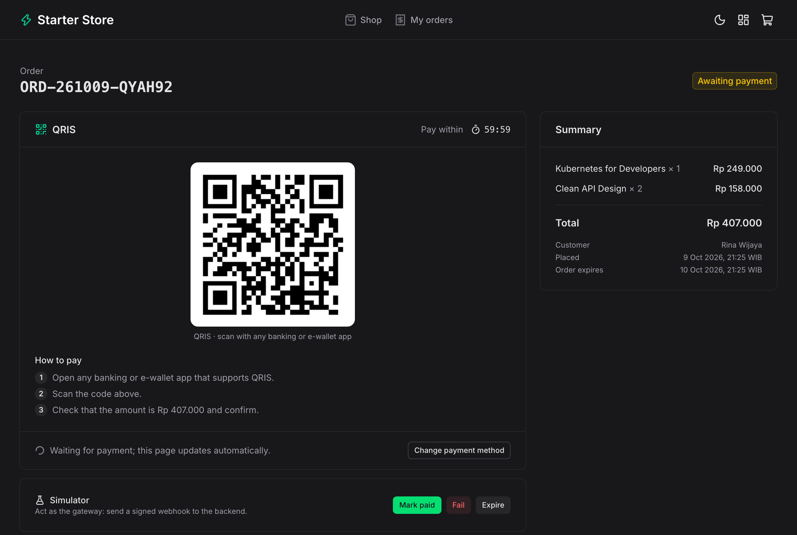
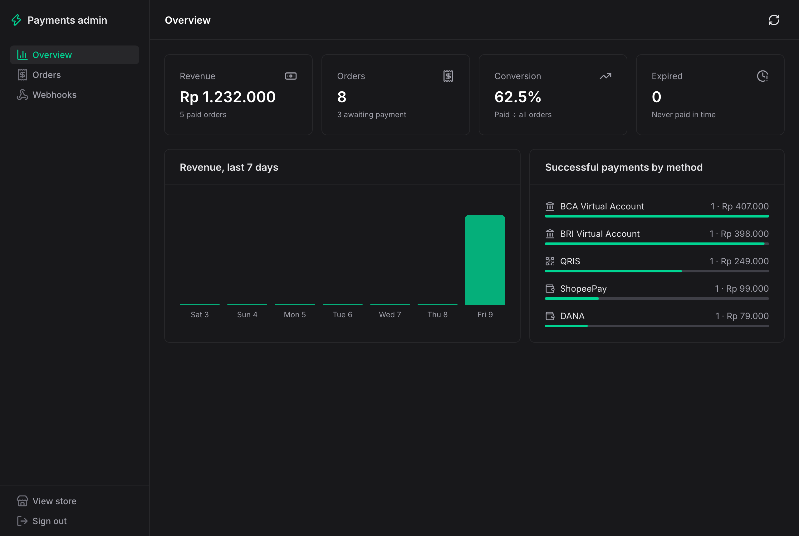
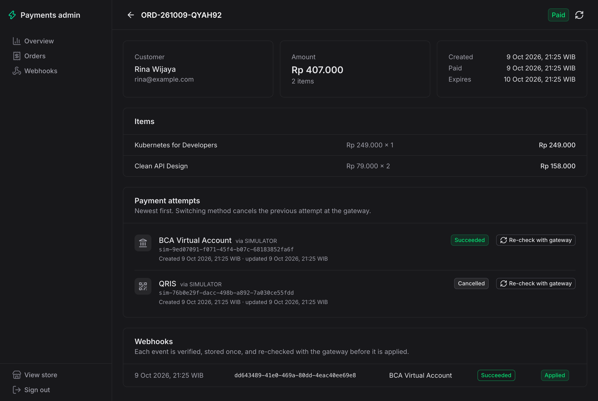

# Payment Gateway Starter: Web

Nuxt 4 + Nuxt UI storefront and admin dashboard for the [payment gateway starter API](https://github.com/Mauludinegi/payment-gateway-starter) (Spring Boot, Xendit, Midtrans). Customers buy from a small catalogue and pay with a virtual account, QRIS, an e-wallet, or at a retail outlet; the order page updates on its own when the gateway's webhook arrives. Admins see revenue, every payment attempt, and every webhook.

<table>
  <tr>
    <td></td>
    <td></td>
  </tr>
  <tr>
    <td></td>
    <td></td>
  </tr>
</table>

## Quick start

Start the API first (Java 21+, no keys needed; it uses the built-in payment simulator):

```bash
git clone https://github.com/Mauludinegi/payment-gateway-starter.git
cd payment-gateway-starter && ./mvnw spring-boot:run
```

Then the web app (Node 22+):

```bash
npm install
npm run dev
```

Open http://localhost:3000, add something to the cart, check out, pick a method, and press **Mark paid** in the simulator panel. The admin is at http://localhost:3000/admin; locally the token is `demo-admin-token` unless you set `ADMIN_TOKEN` on the API.

Everything in Docker (API, PostgreSQL, web), with the API repo cloned next to this one:

```bash
docker compose up --build
```

## What's inside

**Store**

- Catalogue with category filter, cart kept in a cookie (so the server-rendered page shows the right count), and checkout with validation. The browser only sends product IDs and quantities; the API prices the order.
- Payment page: choose from the channels the API has configured, then see a grouped VA number with copy, a QRIS code, a retail payment code, or an e-wallet link with a QR for desktop. Each has how-to-pay steps and a countdown.
- The page polls the order every 3 seconds and switches to "Payment received" when the webhook has been processed. Customers can change method; the API cancels the old one, and an old payment that still arrives is counted.
- "My orders" lists orders placed from this browser.

**Admin**

- Overview: revenue, orders, conversion, expired orders, revenue for the last 7 days, and successful payments by method. Orders paid twice (old method paid after switching) are flagged for refund.
- Orders: search by reference, name, or email; filter by status; paginate.
- Order detail: items, every payment attempt with its gateway reference, and the webhooks for it. **Re-check with gateway** pulls the current status, for when a webhook was missed.
- Webhooks: every verified event with the status the gateway confirmed on re-check and whether it changed anything.

## How it talks to the API

The browser only calls this app. `server/api/[...path].ts` forwards `/api/**` to the Spring Boot API (`NUXT_API_BASE`), so there is no CORS setup and the API does not need to be public, except for `/webhooks/*`, which the gateways call directly.

Admin sign-in posts the token to `/auth/login`, which checks it against the API and stores it in an **http-only, same-site strict cookie**. The proxy adds it as a bearer token to `/api/admin/**` requests; browser JavaScript never sees it. A readable `admin_signed_in` flag lets route middleware redirect to the login page, and any 401 clears the session.

## Configuration

| Variable | Default | Purpose |
| --- | --- | --- |
| `NUXT_API_BASE` | `http://localhost:8080` | API URL as seen from the Nuxt server |

Gateway keys, `ADMIN_TOKEN`, and the e-wallet return URL are set on the API; see its README.

## Stack

Nuxt 4, Nuxt UI 4, Tailwind CSS 4, TypeScript, Zod, `qrcode`. CI runs typecheck, build, and a Docker build.

## License

MIT
