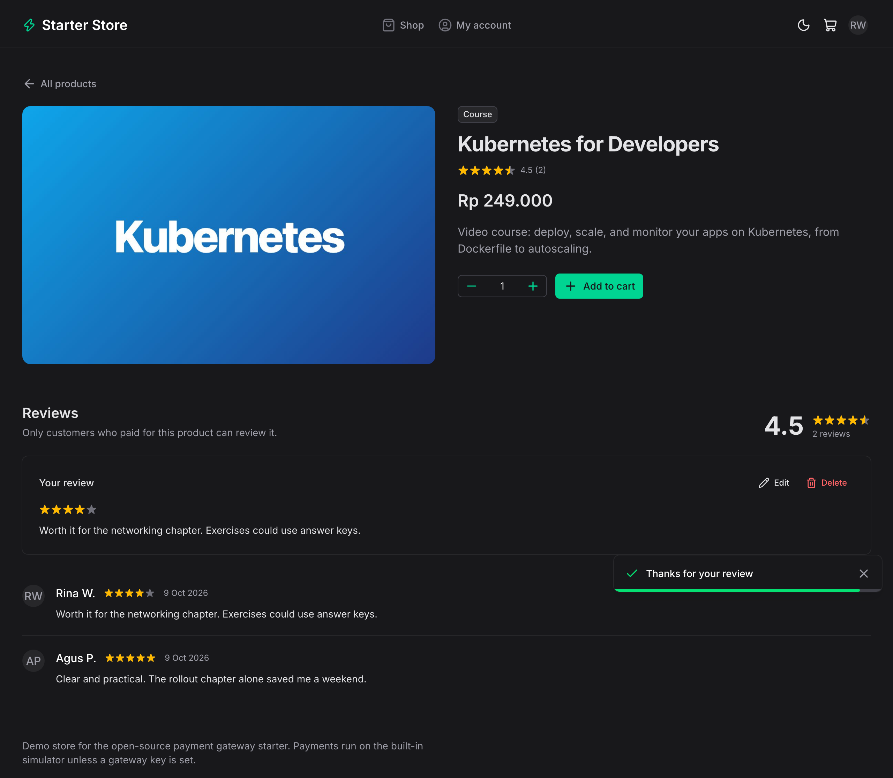
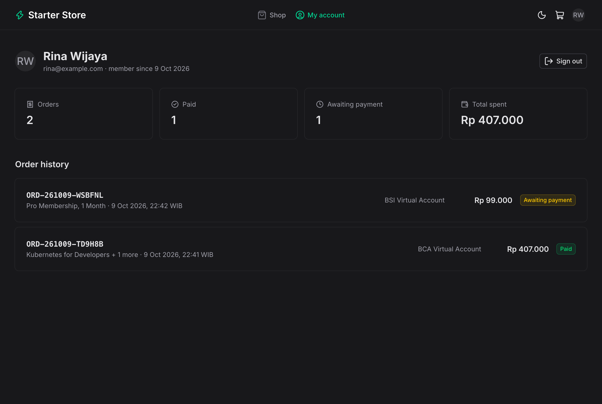
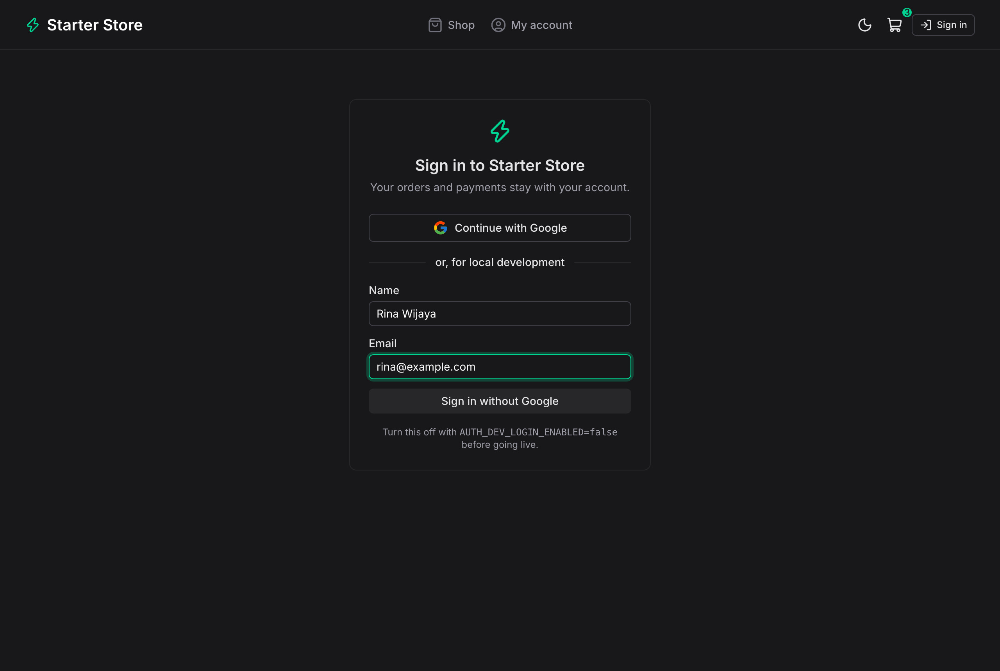
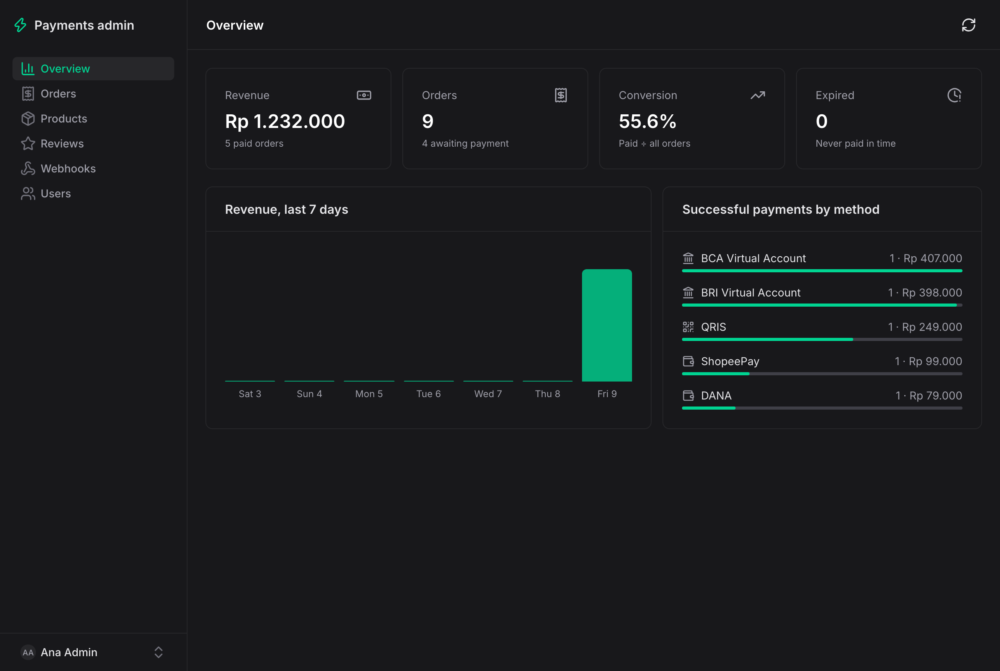
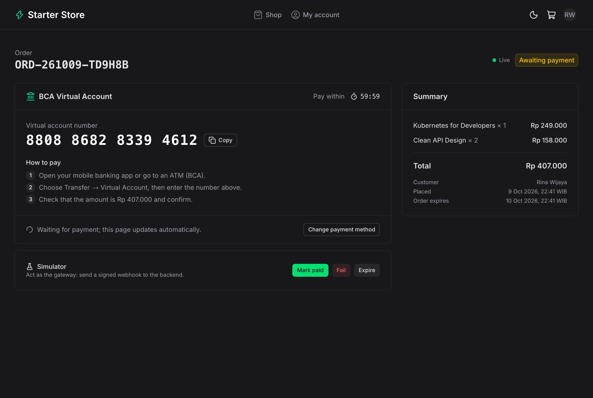
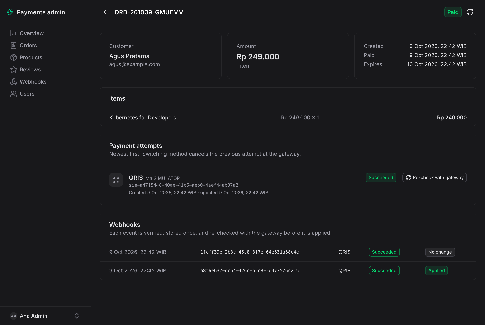
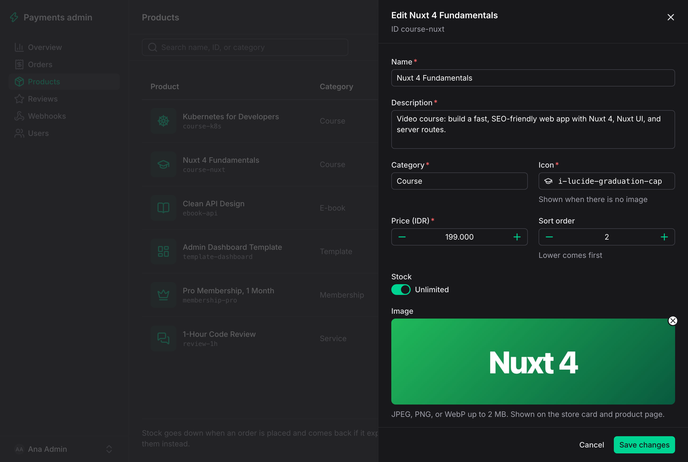
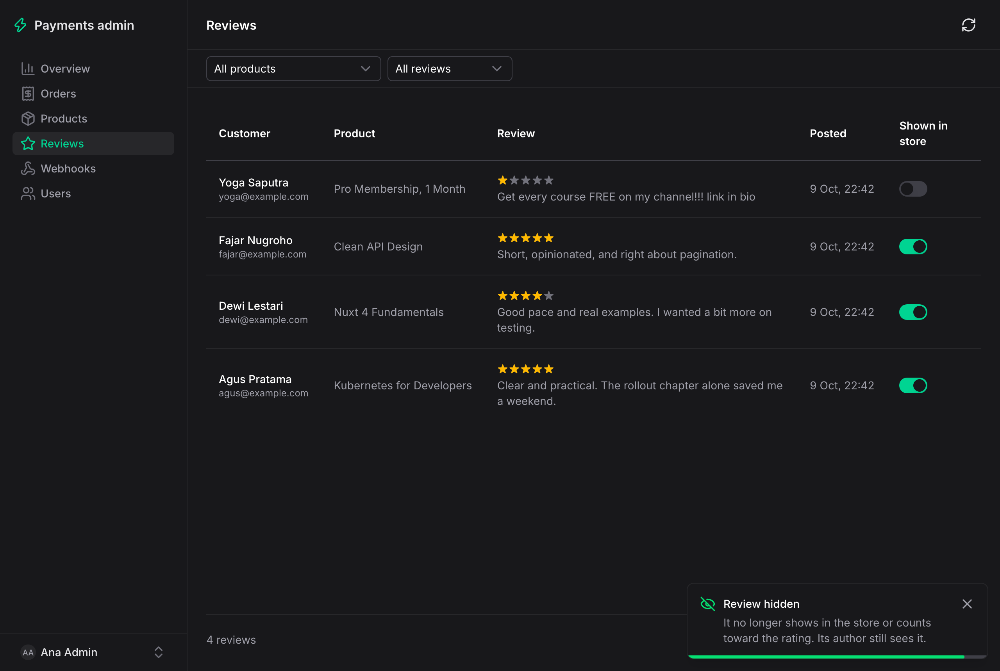

# Payment Gateway Starter: Web

Nuxt 4 + Nuxt UI storefront and admin dashboard for the [payment gateway starter API](https://github.com/Mauludinegi/payment-gateway-starter) (Spring Boot, Xendit, Midtrans). Customers buy from a small catalogue and pay with a virtual account, QRIS, an e-wallet, or at a retail outlet; the order page updates on its own when the gateway's webhook arrives. Customers sign in with Google (Firebase) before checking out, get a dashboard of their orders, and can review what they paid for. Admins manage products (images, stock) and reviews, and see revenue, every payment attempt, and every webhook.

<table>
  <tr>
    <td></td>
    <td></td>
  </tr>
  <tr>
    <td></td>
    <td></td>
  </tr>
  <tr>
    <td></td>
    <td></td>
  </tr>
  <tr>
    <td></td>
    <td></td>
  </tr>
  <tr>
    <td></td>
    <td></td>
  </tr>
</table>

## Quick start

Start the API first (Java 21+, no keys needed; it uses the built-in payment simulator):

```bash
git clone https://github.com/Mauludinegi/payment-gateway-starter.git
cd payment-gateway-starter && ./mvnw spring-boot:run
```

Then the web app (Node 22+):

```bash
npm install
npm run dev
```

Open http://localhost:3000, add something to the cart, sign in (without Firebase keys, use the dev sign-in with any name and email), check out, pick a method, and press **Mark paid** in the simulator panel. For the admin at http://localhost:3000/admin, dev sign-in as `admin@example.com`; with Google, list your account in `ADMIN_EMAILS` on the API.

Everything in Docker (API, PostgreSQL, web), with the API repo cloned next to this one:

```bash
docker compose up --build
```

## What's inside

**Store**

- Catalogue with category filter, product images (or the product's icon), star ratings, and "Only N left" / "Sold out" labels. Each product has its own page with its reviews.
- Cart kept in a cookie (so the server-rendered page shows the right count), and checkout with validation. Browsing and the cart are open; checkout asks the customer to sign in first and comes back to the cart. The browser only sends product IDs and quantities; the API prices the order. Quantities are capped at the stock that is left; if someone else buys it first, the API refuses the order and the cart shows the new stock.
- Reviews: customers with a paid order for a product rate it from 1 to 5 stars with an optional comment, and can edit or delete it. Others see a first name and last initial. If an admin hides a review, its author is told.
- Payment page: choose from the channels the API has configured, then see a grouped VA number with copy, a QRIS code, a retail payment code, or an e-wallet link with a QR for desktop. Each has how-to-pay steps and a countdown.
- The page listens to the order over Server-Sent Events and switches to "Payment received" as soon as the webhook has been processed; a "Live" dot shows the connection. If the stream drops, it polls every 5 seconds until the browser reconnects. Customers can change method; the API cancels the old one, and an old payment that still arrives is counted.
- "My account" (sign-in required) shows the profile, totals (orders, paid, awaiting payment, total spent), and the order history from the API. Order pages are only visible to the customer who placed them.

**Admin**

- Overview: revenue, orders, conversion, expired orders, revenue for the last 7 days, and successful payments by method. Orders paid twice (old method paid after switching) are flagged for refund.
- Orders: search by reference, name, or email; filter by status; paginate.
- Order detail: items, every payment attempt with its gateway reference, and the webhooks for it. **Re-check with gateway** pulls the current status, for when a webhook was missed.
- Webhooks: every verified event with the status the gateway confirmed on re-check and whether it changed anything.
- Products: create and edit products, upload an image (JPEG, PNG, or WebP up to 2 MB; stored in Supabase Storage by the API), set stock or leave it unlimited, and hide products from sale. If an order changes the stock while the form is open, saving asks you to check the new values instead of overwriting them.
- Reviews: filter by product or visibility and hide or show each review.
- Order detail also warns when a payment arrived after the order expired and its stock was sold to someone else.
- Users: search, filter by role, orders and amount spent per account, and promote or demote admins. You cannot change your own role.

## How it talks to the API

The browser only calls this app. `server/api/[...path].ts` forwards `/api/**` to the Spring Boot API (`NUXT_API_BASE`), so there is no CORS setup and the API does not need to be public, except for `/webhooks/*`, which the gateways call directly.

### Customer sign-in

1. `/login` opens the Google popup with the Firebase JS SDK and gets an ID token. Firebase's own session is signed out right away.
2. The token goes to `/auth/google` on this app's server, which passes it to the API. The API verifies it and returns a session token, which the server stores in an **http-only, same-site lax cookie** (`session`); the browser only gets the user.
3. The proxy adds that cookie as a bearer token to customer `/api/**` requests. It refuses `/api/auth/*` sign-in paths, so session tokens never pass through browser JavaScript.
4. A readable `signed_in` flag tells the app to load the user during server rendering; the `auth` route middleware sends signed-out visitors to `/login?redirect=…`. Signing out revokes the session in Redis.

Lax rather than strict, so a customer coming back from an e-wallet app lands on the order page still signed in.

### Admins

Admins sign in like everyone else; the account's role comes from the API (`/api/auth/me`). The app never decodes tokens: the role only decides whether the "Admin dashboard" menu and the `admin` route middleware let you through, and the API checks the role again on every `/api/admin/**` request (`403` for customers). Promoting someone applies on their next request, without signing in again.

### Live payment page

`/api/orders/{id}/events` goes through the same proxy, which streams the response as it arrives, so the browser's `EventSource` gets the session cookie and nothing else changes. The API sends the order once on connect and again on every change, and closes the stream when it is paid or expired. The API marks the stream `X-Accel-Buffering: no` so nginx-style proxies pass it through; if yours buffers anyway, turn buffering off for that path.

## Configuration

| Variable | Default | Purpose |
| --- | --- | --- |
| `NUXT_API_BASE` | `http://localhost:8080` | API URL as seen from the Nuxt server |
| `NUXT_PUBLIC_FIREBASE_API_KEY` | | Firebase web app config, for Google sign-in |
| `NUXT_PUBLIC_FIREBASE_AUTH_DOMAIN` | | e.g. `your-project.firebaseapp.com` |
| `NUXT_PUBLIC_FIREBASE_PROJECT_ID` | | Must match `FIREBASE_PROJECT_ID` on the API |
| `NUXT_PUBLIC_FIREBASE_APP_ID` | | |

The Firebase web config is public by design. In the Firebase console, enable **Authentication > Sign-in method > Google** and add your domain under **Authorized domains** (`localhost` is there by default).

Gateway keys, admin accounts (`ADMIN_EMAILS`), sessions and the catalogue cache (Upstash Redis), product image storage (Supabase Storage), and the e-wallet return URL are set on the API; see its README.

## Stack

Nuxt 4, Nuxt UI 4, Tailwind CSS 4, TypeScript, Zod, Firebase Authentication, `qrcode`. CI runs typecheck, build, and a Docker build.

## License

MIT
